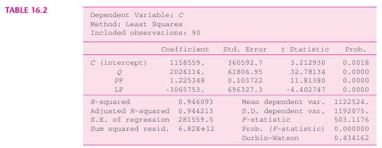
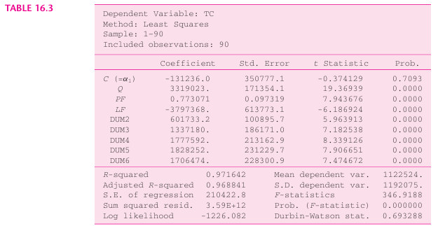
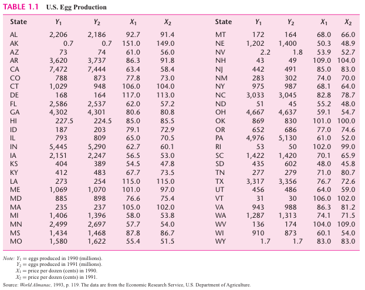

```{css, echo=FALSE}
#TOC::before {
  content: "Contenido";
  display: block;
  font-weight: bold;
  font-size: 1.3em;
  margin-bottom: 8px;
}

th {
  text-align: center !important;
}
```

```{r, echo=FALSE}
htmltools::tags$script(htmltools::HTML(sprintf(
  "document.addEventListener('DOMContentLoaded', function(){var h=document.getElementById('header'); var i=document.createElement('img'); i.src='%s'; i.style.width='300px'; i.style.display='block'; i.style.marginBottom='15px'; h.insertBefore(i, h.firstChild);});",
  knitr::image_uri("logo_egade.png"))))
```

# Introducción

Esta actividad continúa el estudio de los modelos de regresión con datos de panel iniciado en la Actividad Tarea 5, en la que se respondieron las preguntas teóricas del capítulo 16 de Gujarati. En esta actividad el tema se aborda de forma práctica, en dos partes:

- **Parte 1.** Se aplica el procedimiento visto en clase a datos reales: un panel de cinco empresas petroleras de Estados Unidos, con datos trimestrales de sus estados financieros obtenidos de LSEG, para analizar qué variables financieras se relacionan con su nivel de deuda.
- **Parte 2.** Se resuelven los ejercicios empíricos 16.10 y 16.11 del capítulo 16 de Gujarati, que utilizan los datos de costos de aerolíneas y de producción de huevos presentados en el libro.

# Parte 1. Panel: determinantes del apalancamiento en el sector energético

En esta parte se estima un modelo de datos de panel para analizar qué variables financieras se relacionan con el nivel de deuda de cinco empresas petroleras de Estados Unidos, con datos trimestrales de sus estados financieros. Se sigue el mismo procedimiento visto en clase: se estiman los modelos agrupado (*pooling*), de efectos fijos y de efectos aleatorios; se elige entre ellos con las pruebas F y de Hausman; se revisa la confiabilidad de los errores estándar con las pruebas de Wooldridge y de Pesaran y, como ambas detectan problemas, se corrigen los errores estándar del modelo final con el método de Driscoll-Kraay. La parte termina con las conclusiones, en las que los resultados se contrastan con las hipótesis planteadas. Los resultados se interpretan como relaciones entre variables, no como relaciones de causalidad.

## 1.1 Planteamiento

En esta sección se presentan la pregunta que se busca responder, las teorías que permiten plantear hipótesis sobre ella y los criterios con los que se eligieron el sector y las empresas.

### 1.1.1 Pregunta de investigación y teoría

La pregunta que se busca responder es **qué variables financieras se relacionan con el nivel de deuda de una empresa**. Es una pregunta clásica de las finanzas corporativas, conocida como el estudio de la estructura de capital, y la literatura ofrece dos explicaciones principales que permiten plantear signos esperados para cada variable:

- **Teoría de la jerarquía de financiamiento (*pecking order*).** Las empresas prefieren financiarse primero con sus propias utilidades y solo después con deuda. Según esta teoría, las empresas más rentables necesitan menos deuda, por lo que la relación entre rentabilidad y apalancamiento sería negativa.
- **Teoría del equilibrio (*trade-off*).** Las empresas eligen su nivel de deuda comparando el beneficio fiscal de los intereses con el riesgo de quiebra. Según esta teoría, las empresas más rentables pueden aprovechar mejor ese beneficio y sostener más deuda, por lo que la relación sería positiva.

Además de la rentabilidad, se incluyen la tangibilidad de los activos y el tamaño de la empresa, dos variables que la literatura asocia de forma consistente con un mayor acceso a la deuda.

### 1.1.2 Selección del sector y de las empresas

Se eligió un solo sector, el energético, por tres razones. Primero, los modelos de panel suponen que la relación entre las variables (las pendientes) es la misma para todas las empresas, un supuesto que solo es razonable entre empresas con un modelo de negocio similar. Segundo, la deuda y la rentabilidad de las petroleras cambiaron mucho en el periodo de estudio: en 2020, con el colapso del precio del petróleo por la pandemia, las dos empresas integradas aumentaron su deuda (la de XOM pasó de 47,074 a 69,515 millones de dólares y la de CVX de 26,973 a 34,053 millones entre el cuarto trimestre de 2019 y el segundo de 2020); en 2022, con precios altos, las cinco empresas la redujeron o la mantuvieron; y en 2026 sus utilidades aumentaron con la subida del precio del petróleo. Esa variación a lo largo del tiempo es la que aprovechan los modelos de panel. Tercero, permite dar continuidad a las Tareas 2 y 5, en las que ya se analizaron XOM, CVX y COP.

Las cinco empresas seleccionadas son algunas de las principales petroleras de Estados Unidos. A lo largo del documento se identifican por su clave de cotización (*ticker*):

| Ticker | Empresa | Tipo de negocio |
|---|---|---|
| XOM | Exxon Mobil Corporation | Integrada: exploración, producción, refinación y química |
| CVX | Chevron Corporation | Integrada: exploración, producción, refinación y química |
| COP | ConocoPhillips | Exploración y producción |
| OXY | Occidental Petroleum Corporation | Exploración y producción, con un negocio químico |
| DVN | Devon Energy Corporation | Exploración y producción |


## 1.2 Datos de LSEG

Los datos se obtuvieron de LSEG con el complemento de Excel, para las cinco empresas presentadas en la sección 1.1.2. Se descargaron cuatro cuentas de sus estados financieros trimestrales, con la vista estandarizada de LSEG, para que la definición de cada cuenta sea la misma en todas las empresas:

| Cuenta           | Campo de LSEG                       |
|------------------|-------------------------------------|
| Deuda total      | `TR.TotalDebtOutstanding`           |
| Activos totales  | `TR.TotalAssetsReported`            |
| EBITDA           | `TR.EBITDA`                         |
| Activo fijo neto | `TR.PropertyPlantEquipmentTotalNet` |

La deuda total corresponde a la deuda financiera de la empresa, es decir, la que genera intereses: la deuda de corto plazo, la porción circulante de la deuda de largo plazo y la deuda de largo plazo, incluidos los arrendamientos financieros. No incluye el resto del pasivo, como las cuentas por pagar a proveedores, los impuestos diferidos o las provisiones, ni el capital de los accionistas. Todas las cifras son valores en libros, tomados del balance general de cada empresa.

En el caso del EBITDA, el campo `TR.EBITDA` utiliza una definición de LSEG que difiere ligeramente del renglón de EBITDA de su estado de resultados estandarizado; por ejemplo, para XOM en el segundo trimestre de 2026 el campo reporta 28,603 millones de dólares y el estado de resultados 27,447 millones. Como se utiliza el mismo campo para las cinco empresas y los 28 trimestres, la definición es consistente en toda la muestra.

El periodo va del tercer trimestre de 2019 al segundo trimestre de 2026, es decir, 28 trimestres, y se eligió por tres razones:

1. **Cubre los últimos siete años,** el máximo que permite la instrucción de la actividad (de 5 a 7 años).
2. **Termina en el trimestre más reciente que las cinco empresas ya habían reportado.** Al momento de la descarga, algunas empresas aún no publicaban el tercer trimestre de 2026. Incluirlo para unas y no para otras produciría un panel no balanceado, por lo que se tomó como último trimestre el segundo de 2026, común a todas.
3. **Incluye dos choques de rentabilidad en sentido contrario:** el colapso del precio del petróleo en 2020 y su fuerte aumento en el segundo trimestre de 2026, asociado al conflicto en Medio Oriente. En ese trimestre, el EBITDA de las cinco empresas aumentó de forma importante; por ejemplo, el de XOM pasó de 13,630 a 28,603 millones de dólares. Estos movimientos dan al modelo variación suficiente para medir la relación entre rentabilidad y deuda.

Una limitación del periodo es que casi todas las empresas realizaron fusiones o adquisiciones importantes: DVN con WPX (2021) y con Coterra (2026), COP con Concho (2021) y con Marathon Oil (2024), XOM con Pioneer (2024) y CVX con Hess (2025), entre otras. Estas operaciones se observan como saltos en los activos de cada empresa; por ejemplo, los activos de DVN pasaron de 32,543 a 70,893 millones de dólares en el segundo trimestre de 2026. Para reducir su efecto, el modelo utiliza razones financieras en lugar de montos, ya que la deuda y los activos de la empresa adquirida se suman al mismo tiempo.

Los datos se importan del archivo de Excel y los montos se expresan en millones de dólares:

```{r datos-lseg, message=FALSE, warning=FALSE}
library(readxl)

datos <- read_excel("Tarea6_A01452205_datosLSEG.xlsx", sheet = "panel_energia_valores")
colnames(datos) <- c("empresa", "fecha", "deuda", "activos", "ebitda", "activo_fijo")

datos$empresa <- sub("\\.N$", "", datos$empresa)
datos$fecha   <- as.Date(datos$fecha)
datos[, 3:6]  <- datos[, 3:6] / 1e6
datos <- datos[order(datos$empresa, datos$fecha), ]

knitr::kable(head(datos), digits = 0, row.names = FALSE,
             format.args = list(big.mark = ","),
             col.names = c("Empresa", "Fecha de cierre", "Deuda total", "Activos totales",
                           "EBITDA", "Activo fijo neto"),
             caption = "Primeras observaciones de la base (millones de dólares)")
```

La base está en formato largo: cada fila es una empresa en un trimestre, que es la estructura que requiere el paquete `plm`. Para confirmar que el panel está balanceado, se revisa que cada empresa tenga el mismo número de trimestres y las mismas fechas de inicio y fin:

```{r verificacion-panel}
resumen_panel <- do.call(rbind, lapply(split(datos, datos$empresa), function(d)
  data.frame(Empresa = d$empresa[1], Trimestres = nrow(d),
             Primero = min(d$fecha), Ultimo = max(d$fecha))))

knitr::kable(resumen_panel, row.names = FALSE,
             col.names = c("Empresa", "Trimestres", "Primer trimestre", "Último trimestre"),
             caption = "Estructura del panel por empresa")
```

Las cinco empresas tienen 28 trimestres, del 30 de septiembre de 2019 al 30 de junio de 2026, por lo que el panel está balanceado: 5 empresas × 28 trimestres = 140 observaciones.

## 1.3 Construcción de las variables

Con las cuentas de la sección anterior se construyen las variables del modelo. Se utilizan razones financieras en lugar de montos, porque las empresas tienen tamaños muy distintos (los activos de XOM son más de diez veces los de DVN durante buena parte del periodo) y, con montos, la regresión estaría dominada por las empresas más grandes. Las tres razones se expresan en porcentaje:

| Variable | Definición | Qué mide |
|---|---|---|
| `apalancamiento` (dependiente) | Deuda total / activos totales × 100 | Proporción de los activos financiada con deuda |
| `rentabilidad` | EBITDA / activos totales × 100 | Rentabilidad operativa del trimestre |
| `tangibilidad` | Activo fijo neto / activos totales × 100 | Proporción de activos físicos que pueden servir como garantía |
| `tamano` | Logaritmo natural de los activos totales | Tamaño de la empresa |

Como el EBITDA es un flujo trimestral y los activos un saldo al cierre, la rentabilidad corresponde a un trimestre, aproximadamente una cuarta parte de la anual.

Las variables se calculan a partir de las cuentas de la sección 1.2:

```{r variables}
datos$apalancamiento <- datos$deuda / datos$activos * 100
datos$rentabilidad   <- datos$ebitda / datos$activos * 100
datos$tangibilidad   <- datos$activo_fijo / datos$activos * 100
datos$tamano         <- log(datos$activos)
```

## 1.4 Especificación del modelo e hipótesis

En esta sección se presenta la ecuación que se estima y se plantean, antes de conocer los resultados, las hipótesis sobre el signo de cada pendiente y sobre el resultado de cada prueba de especificación.

### 1.4.1 Ecuación del modelo

Con las variables de la sección anterior, el modelo que se estima es:

$$\text{Apalancamiento}_{it} = \alpha_i + \beta_1 \, \text{Rentabilidad}_{it} + \beta_2 \, \text{Tangibilidad}_{it} + \beta_3 \ln(\text{Activos}_{it}) + u_{it}$$

donde:

- $i$ representa a cada empresa ($i = 1, \dots, 5$) y $t$ a cada trimestre ($t = 1, \dots, 28$).
- $\alpha_i$ es el intercepto, que recoge las características propias de cada empresa que no cambian en el tiempo. La forma en que se trata este término es lo que distingue a los modelos de las secciones siguientes: en el modelo agrupado es el mismo para todas las empresas ($\alpha_i = \alpha$); en el de efectos fijos se estima uno distinto para cada empresa; y en el de efectos aleatorios se trata como una desviación aleatoria alrededor de un promedio común ($\alpha_i = \alpha + \varepsilon_i$), que pasa a formar parte del error.
- $\beta_1$, $\beta_2$ y $\beta_3$ son las pendientes, que se suponen iguales para las cinco empresas.
- $u_{it}$ es el término de error de la empresa $i$ en el trimestre $t$.

### 1.4.2 Hipótesis sobre los signos

Las hipótesis sobre los signos de las pendientes son:

| Pendiente | Variable | Signo esperado | Fundamento |
|---|---|---|---|
| $\beta_1$ | Rentabilidad | Negativo ($\beta_1 < 0$) según la jerarquía de financiamiento; positivo ($\beta_1 > 0$) según la teoría del equilibrio | El signo estimado permite contrastar ambas teorías |
| $\beta_2$ | Tangibilidad | Positivo ($\beta_2 > 0$) | Los activos físicos sirven como garantía de la deuda |
| $\beta_3$ | Tamaño | Positivo ($\beta_3 > 0$) | Las empresas grandes tienen menor riesgo y mejor acceso al crédito |

Como el tamaño está en logaritmo, $\beta_3$ dividido entre 100 indica cuántos puntos porcentuales cambia el apalancamiento cuando los activos aumentan 1%. Las demás pendientes indican cuántos puntos porcentuales cambia el apalancamiento cuando la variable correspondiente aumenta un punto porcentual.

### 1.4.3 Resultados esperados de las pruebas

Además de los signos de las pendientes, antes de estimar los modelos se plantean las siguientes expectativas sobre los efectos individuales y sobre los errores del modelo:

| Aspecto | Prueba | Resultado esperado | Razón |
|---|---|---|---|
| Efectos individuales | F de efectos individuales | Sí existen: se espera rechazar el modelo agrupado | Las empresas tienen modelos de negocio y políticas financieras distintas (XOM y CVX son integradas; COP, OXY y DVN se dedican a la exploración y producción), por lo que es de esperar que cada una tenga un nivel de deuda propio |
| Tipo de efecto | Hausman | Efectos fijos | Las cinco empresas no son una muestra aleatoria del sector, sino empresas elegidas deliberadamente; además, es probable que sus características propias (como su modelo de negocio) estén relacionadas con su rentabilidad, su tangibilidad y su tamaño |
| Autocorrelación serial | Wooldridge | Sí existe | El nivel de deuda de una empresa cambia lentamente de un trimestre a otro, por lo que es probable que sus errores también persistan en el tiempo |
| Dependencia entre empresas | Pesaran | Sí existe | Las cinco empresas están expuestas a los mismos choques del sector, en particular a los cambios en el precio del petróleo, que afectan a todas en el mismo trimestre |

Estas expectativas se contrastan con los resultados en la sección de conclusiones.

## 1.5 Estadística descriptiva

En esta sección se describen los datos antes de estimar los modelos: primero para la muestra completa y después por empresa.

### 1.5.1 Estadística descriptiva de la muestra

La siguiente tabla resume las cuatro variables para toda la muestra. Además de la desviación estándar total, se calculan dos desviaciones propias de los datos de panel: la desviación **entre empresas**, que mide qué tan distintos son los promedios de cada empresa, y la desviación **dentro de cada empresa**, que mide cuánto se mueve cada empresa alrededor de su propio promedio a lo largo del tiempo. Esta distinción es importante porque el modelo de efectos fijos utiliza únicamente la variación dentro de cada empresa:

```{r descriptiva}
variables_modelo <- c("apalancamiento", "rentabilidad", "tangibilidad", "tamano")

descriptiva <- do.call(rbind, lapply(variables_modelo, function(v) {
  x <- datos[[v]]
  promedio_empresa <- ave(x, datos$empresa)
  data.frame(Media     = mean(x),
             Mediana   = median(x),
             DE_total  = sd(x),
             DE_entre  = sd(tapply(x, datos$empresa, mean)),
             DE_dentro = sd(x - promedio_empresa),
             Minimo    = min(x),
             Maximo    = max(x))
}))
descriptiva <- cbind(Variable = c("Apalancamiento (%)", "Rentabilidad (%)",
                                  "Tangibilidad (%)", "Tamaño (log de activos)"),
                     descriptiva)

knitr::kable(descriptiva, digits = 2, row.names = FALSE,
             col.names = c("Variable", "Media", "Mediana", "Desv. est. total",
                           "Desv. est. entre empresas", "Desv. est. dentro de cada empresa",
                           "Mínimo", "Máximo"),
             caption = "Estadística descriptiva, 140 observaciones (5 empresas × 28 trimestres)")
```

La tabla permite conocer la magnitud y la variación de cada variable:

- **Apalancamiento:** en promedio, el 21.7% de los activos de las empresas está financiado con deuda, con un rango que va de 7.8% (CVX en el tercer trimestre de 2023) a 45.9% (DVN en el cuarto trimestre de 2020). Su variación es mayor entre empresas (9.72) que dentro de cada empresa (5.09), aunque esta última es considerable: cerca de una cuarta parte de la variación del apalancamiento ocurre dentro de las empresas a lo largo del tiempo.
- **Rentabilidad:** en promedio, las empresas generan un EBITDA trimestral equivalente al 4.7% de sus activos. Es la única variable que cambia más dentro de cada empresa (2.16) que entre empresas (1.17), lo que refleja su dependencia del precio del petróleo: su mínimo es −2.9% (DVN en el segundo trimestre de 2020, durante el colapso del precio por la pandemia) y su máximo 13.4% (DVN en el segundo trimestre de 2022).
- **Tangibilidad:** en promedio, el 70.1% de los activos es activo fijo, una proporción alta, propia de una industria intensiva en capital. Varía tanto entre empresas (7.99) como dentro de cada empresa (5.60).
- **Tamaño:** casi toda su variación es entre empresas (1.12), y muy poca dentro de cada empresa (0.23). Los cambios de tamaño de una misma empresa en el periodo provienen principalmente de las fusiones y adquisiciones descritas en la sección 1.2. Por ello, en el modelo de efectos fijos, el coeficiente del tamaño se estimará con poca variación y deberá interpretarse con cautela.

En el apalancamiento, la mediana (19.27%) es menor que la media (21.74%), porque los niveles de deuda más altos, los de OXY y DVN, elevan el promedio; en las demás variables, la media y la mediana son cercanas.

### 1.5.2 Promedios por empresa

Para comparar a las empresas entre sí, la siguiente tabla muestra el promedio de cada variable por empresa:

```{r promedios-empresa}
promedios <- aggregate(cbind(apalancamiento, rentabilidad, tangibilidad, tamano) ~ empresa,
                       data = datos, FUN = mean)

knitr::kable(promedios, digits = 2, row.names = FALSE,
             col.names = c("Empresa", "Apalancamiento (%)", "Rentabilidad (%)",
                           "Tangibilidad (%)", "Tamaño (log de activos)"),
             caption = "Promedio de las variables por empresa, 3T 2019 a 2T 2026")
```

La tabla muestra diferencias importantes entre empresas. Las dos empresas más grandes, XOM y CVX, tienen el menor apalancamiento promedio (12.8% y 12.0%) y también la menor tangibilidad (63.5% y 61.2%), mientras que DVN y OXY tienen el mayor apalancamiento (30.9% y 32.6%) y la mayor tangibilidad (74.7% y 80.6%). Entre empresas, la tangibilidad se relaciona con el apalancamiento en el sentido esperado, pero el tamaño lo hace en sentido contrario: las empresas más grandes son las menos endeudadas. Una posible explicación es que XOM y CVX son empresas integradas, con negocios de refinación y química que les dan flujos más estables, mientras que COP, OXY y DVN se dedican principalmente a la exploración y producción. Estas son comparaciones entre empresas; los modelos de panel de las secciones siguientes permiten distinguirlas de la relación que existe dentro de cada empresa a lo largo del tiempo.

## 1.6 Regresión MCO y modelo pooling

En esta sección se estima el modelo sin aprovechar la estructura de panel de los datos: primero con una regresión MCO y después con el modelo agrupado (*pooling*) del paquete `plm`, que sirve como base de comparación para los modelos de las secciones siguientes.

### 1.6.1 Regresión MCO

Como punto de partida se estima el modelo por mínimos cuadrados ordinarios (MCO), tratando las 140 observaciones como si fueran independientes, sin tomar en cuenta que provienen de las mismas cinco empresas. Para no repetir la ecuación en cada modelo, se guarda una sola vez:

```{r mco, message=FALSE, warning=FALSE}
library(plm)
library(lmtest)

formula_apal <- apalancamiento ~ rentabilidad + tangibilidad + tamano

apal_mco <- lm(formula_apal, data = datos)
summary(apal_mco)
```

El modelo explica el 72.2% de la variación del apalancamiento ($R^2$ ajustado de 0.7218) y es significativo en conjunto (F = 121.2, con un valor p prácticamente de cero).

El intercepto (91.77) no tiene una interpretación económica, ya que corresponde a una empresa con rentabilidad y tangibilidad de cero y activos de un millón de dólares, valores fuera del rango de la muestra.

Las tres variables son significativas al 0.1%:

- **Rentabilidad (−1.1625):** cuando la rentabilidad aumenta un punto porcentual, el apalancamiento disminuye 1.16 puntos porcentuales. El signo negativo es consistente con la teoría de jerarquía de financiamiento.
- **Tangibilidad (0.2882):** cuando la proporción de activo fijo aumenta un punto porcentual, el apalancamiento aumenta 0.29 puntos porcentuales, en el sentido esperado.
- **Tamaño (−7.2982):** cuando los activos aumentan 10%, el apalancamiento disminuye aproximadamente 0.73 puntos porcentuales. El signo es contrario al esperado.

Sin embargo, este modelo trata las 140 observaciones como si fueran independientes y supone que todas las empresas tienen el mismo intercepto. Por eso mezcla las diferencias entre empresas con los cambios de cada empresa a lo largo del tiempo. El signo negativo del tamaño, por ejemplo, podría reflejar solamente lo observado en la tabla de promedios de la sección 1.5: las empresas más grandes, XOM y CVX, son también las menos endeudadas.

### 1.6.2 Modelo pooling

El modelo agrupado utiliza la ecuación de la sección 1.4 con un solo intercepto para todas las empresas:

$$\text{Apalancamiento}_{it} = \alpha + \beta_1 \, \text{Rentabilidad}_{it} + \beta_2 \, \text{Tangibilidad}_{it} + \beta_3 \ln(\text{Activos}_{it}) + u_{it}$$

El intercepto $\alpha$ no lleva el subíndice $i$: el modelo supone que las cinco empresas tienen el mismo nivel de deuda de fondo y que cualquier diferencia entre ellas se explica solo por sus variables. Es un supuesto fuerte, que se pone a prueba en la sección 1.7.
Este modelo se estima con el paquete `plm`, indicando que la unidad de corte transversal es la empresa y la dimensión temporal es la fecha de cierre del trimestre. El modelo agrupado (*pooling*) es la misma regresión MCO, por lo que debe producir los mismos coeficientes; sirve para confirmar que el panel quedó bien definido y como modelo base para las comparaciones siguientes:

```{r pooling}
apal_po <- plm(formula_apal, data = datos, model = "pooling",
               index = c("empresa", "fecha"))
summary(apal_po)
```

Como se esperaba, el modelo agrupado produce exactamente los mismos coeficientes, errores estándar y $R^2$ que la regresión MCO, ya que se trata del mismo cálculo. El encabezado de la salida confirma que el panel quedó bien definido: `Balanced Panel: n = 5, T = 28, N = 140`, es decir, 5 empresas observadas durante 28 trimestres, sin datos faltantes. Este modelo es la base de comparación para la prueba de la siguiente sección, que evalúa si es correcto suponer un solo intercepto para todas las empresas.

## 1.7 Prueba F de efectos individuales

El modelo agrupado supone que todas las empresas tienen el mismo intercepto, es decir, que no existen características propias de cada empresa que afecten su nivel de deuda. La prueba F de efectos individuales evalúa ese supuesto comparando el modelo agrupado con el de efectos fijos. La hipótesis nula es que no hay efectos individuales y que, por lo tanto, el modelo agrupado es adecuado:

```{r prueba-f}
pFtest(formula_apal, data = datos, model = "within",
       index = c("empresa", "fecha"))
```

El valor del estadístico es F = 21.48, con 4 y 132 grados de libertad y un valor p prácticamente de cero, por lo que se rechaza la hipótesis nula: las empresas tienen efectos individuales significativos y el modelo agrupado no es adecuado. Los grados de libertad tienen una interpretación directa: el 4 corresponde a los interceptos adicionales que agrega el modelo de efectos fijos (uno por empresa, menos la de referencia), y el 132 a las 140 observaciones menos los 5 interceptos y las 3 pendientes.

La magnitud del efecto puede verse en la suma de cuadrados de los residuos: al permitir un intercepto propio para cada empresa, el error no explicado disminuye de 3,861.5 a 2,339.0, es decir, un 39%. El resultado coincide con lo esperado en la sección 1.4.3: cada empresa tiene un nivel de deuda propio, asociado a su modelo de negocio y a su política financiera. Queda por decidir si esos efectos deben tratarse como fijos o como aleatorios, lo que se resuelve con la prueba de Hausman de la sección 1.10.

## 1.8 Modelo de efectos fijos

El modelo de efectos fijos asigna a cada empresa su propio intercepto, con lo que controla todas sus características que no cambian en el tiempo, aunque no estén en la base de datos (por ejemplo, su modelo de negocio o su política financiera). Sus coeficientes se estiman únicamente con la variación de cada empresa a lo largo del tiempo. Primero se estima el modelo y después se comparan sus resultados con los de la regresión MCO de la sección 1.6.

En términos de la ecuación de la sección 1.4, el modelo de efectos fijos permite un intercepto distinto para cada empresa, $\alpha_i$, que recoge su efecto individual, es decir, su nivel de deuda de fondo:

$$\text{Apalancamiento}_{it} = \alpha_i + \beta_1 \, \text{Rentabilidad}_{it} + \beta_2 \, \text{Tangibilidad}_{it} + \beta_3 \ln(\text{Activos}_{it}) + u_{it}$$

Se llama "fijo" porque ese intercepto se trata como un valor propio de cada empresa que se estima, y que no cambia en el tiempo. Para estimar las pendientes, a cada variable se le resta su promedio por empresa (indicado con una barra). Como el intercepto es constante en el tiempo, al restar el promedio desaparece:

$$\begin{aligned}
\text{Apalancamiento}_{it} - \overline{\text{Apalancamiento}}_i = \; & \beta_1 (\text{Rentabilidad}_{it} - \overline{\text{Rentabilidad}}_i) + \beta_2 (\text{Tangibilidad}_{it} - \overline{\text{Tangibilidad}}_i) \\
& + \beta_3 (\ln \text{Activos}_{it} - \overline{\ln \text{Activos}}_i) + (u_{it} - \bar{u}_i)
\end{aligned}$$

Por esta razón, la salida del modelo no reporta un intercepto, y sus coeficientes reflejan únicamente cómo se mueve cada empresa alrededor de su propio promedio.

### 1.8.1 Estimación

El modelo se estima con la opción `model = "within"`, que resta a cada observación el promedio de su empresa:

```{r efectos-fijos}
apal_fe <- plm(formula_apal, data = datos, model = "within",
               index = c("empresa", "fecha"))
summary(apal_fe)
```

El $R^2$ que reporta este modelo es el *within* (0.3512): mide la proporción de la variación del apalancamiento dentro de cada empresa que explican las variables, por lo que no es comparable directamente con el $R^2$ del modelo agrupado. La suma total de cuadrados muestra cuánta variación hay dentro de las empresas: 3,605.2 en el modelo de efectos fijos, frente a 14,186 en el agrupado, es decir, alrededor del 25% de la variación total del apalancamiento ocurre dentro de cada empresa a lo largo del tiempo. La prueba F del final (F = 23.82, valor p prácticamente de cero) indica que las tres variables son significativas en conjunto.

### 1.8.2 Comparación con MCO e interpretación

Para identificar qué cambia al controlar las características propias de cada empresa, la siguiente tabla compara los coeficientes y valores p del modelo de efectos fijos con los de la regresión MCO. Como esta comparación se repite en las secciones 1.9 y 1.13, primero se define una función que extrae de cada modelo el coeficiente, con sus asteriscos de significancia, y el valor p:

```{r comparacion-mco-fe}
resumen_coef <- function(modelo, variables = c("rentabilidad", "tangibilidad", "tamano")) {
  ct <- coef(summary(modelo))[variables, ]
  p  <- ct[, 4]
  estrellas <- ifelse(p < 0.001, "***", ifelse(p < 0.01, "**",
               ifelse(p < 0.05, "*", ifelse(p < 0.1, ".", ""))))
  data.frame(coef = paste(formatC(ct[, 1], format = "f", digits = 4), estrellas),
             p    = ifelse(p < 0.0001, "< 0.0001", formatC(p, format = "f", digits = 4)))
}

mco <- resumen_coef(apal_mco)
fe  <- resumen_coef(apal_fe)

comparacion_fe <- data.frame(Variable = c("Rentabilidad", "Tangibilidad", "Tamaño"),
                             mco$coef, mco$p, fe$coef, fe$p)

knitr::kable(comparacion_fe, row.names = FALSE, align = c("l", "r", "r", "r", "r"),
             col.names = c("Variable", "MCO: coeficiente", "MCO: valor p",
                           "Efectos fijos: coeficiente", "Efectos fijos: valor p"),
             caption = "Comparación de coeficientes: MCO vs. efectos fijos")
```

Significancia: \*\*\* al 0.1%, \*\* al 1%, \* al 5% y . al 10%.

La tabla muestra que, al controlar las características propias de cada empresa, los resultados cambian de forma importante respecto de la regresión MCO:

- **Rentabilidad (−0.8002):** sigue siendo negativa y significativa al 0.1%. Cuando la rentabilidad de una misma empresa aumenta un punto porcentual, su apalancamiento disminuye 0.80 puntos porcentuales. Esta es la evidencia más directa a favor de la teoría de jerarquía de financiamiento: en los trimestres en que las empresas generaron más flujo operativo, redujeron su deuda.
- **Tangibilidad (−0.0013):** deja de ser significativa (valor p de 0.99). La relación positiva observada en el modelo agrupado provenía de las diferencias entre empresas (las empresas con más activo fijo, como OXY y DVN, son también las más endeudadas), pero no se observa dentro de cada empresa a lo largo del tiempo.
- **Tamaño (−8.9180):** sigue siendo negativo y significativo al 0.1%. Cuando los activos de una misma empresa aumentan 10%, su apalancamiento disminuye aproximadamente 0.89 puntos porcentuales. Dentro de cada empresa, los cambios de tamaño en el periodo se deben principalmente a las fusiones y adquisiciones descritas en la sección 1.2. Una explicación posible es que estas operaciones se pagaron en buena medida con acciones, lo que aumenta los activos sin aumentar la deuda en la misma proporción y reduce el apalancamiento. Además, como los activos son también el denominador del apalancamiento, parte de esta relación puede ser mecánica.

## 1.9 Modelo de efectos aleatorios

El modelo de efectos aleatorios también reconoce que cada empresa tiene su propio nivel de deuda de fondo, pero lo trata de forma distinta al de efectos fijos: en lugar de estimar un intercepto para cada empresa, supone que las diferencias entre empresas son aleatorias, alrededor de un intercepto promedio común, y las incorpora al término de error. En términos de la ecuación de la sección 1.4:

$$\text{Apalancamiento}_{it} = \alpha + \beta_1 \, \text{Rentabilidad}_{it} + \beta_2 \, \text{Tangibilidad}_{it} + \beta_3 \ln(\text{Activos}_{it}) + (\varepsilon_i + u_{it})$$

donde $\alpha$ es el intercepto promedio de todas las empresas y $\varepsilon_i$ es la desviación propia de cada empresa respecto de ese promedio, que pasa a formar parte del error junto con $u_{it}$. Se llama "aleatorio" porque cada empresa se trata como si hubiera sido extraída al azar de una población más grande de empresas.

Para estimarlo, a cada variable se le resta solo una fracción $\theta$ de su promedio por empresa, en lugar del promedio completo:

$$\text{Apalancamiento}_{it} - \theta \, \overline{\text{Apalancamiento}}_i = \alpha(1 - \theta) + \beta_1 (\text{Rentabilidad}_{it} - \theta \, \overline{\text{Rentabilidad}}_i) + \dots + \text{error}$$

Si $\theta = 0$, el modelo es igual al agrupado; si $\theta = 1$, es igual al de efectos fijos. Por eso, efectos aleatorios aprovecha tanto la variación dentro de cada empresa como parte de la variación entre empresas, lo que lo hace más eficiente. A cambio, requiere un supuesto que el modelo de efectos fijos no necesita: que la característica propia de cada empresa ($\varepsilon_i$) no esté correlacionada con las variables explicativas. Primero se estima el modelo y después se comparan sus resultados con los de los dos modelos anteriores.

### 1.9.1 Estimación

El modelo se estima con la opción `model = "random"`:

```{r efectos-aleatorios}
apal_re <- plm(formula_apal, data = datos, model = "random",
               index = c("empresa", "fecha"))
summary(apal_re)
```

La sección `Effects` de la salida divide la varianza del error en sus dos componentes. El componente individual, que corresponde a las diferencias entre empresas, representa el 6.4% de la varianza (1.203), y el componente idiosincrático, que es el error de cada empresa en cada trimestre, el 93.6% (17.720). Con estas varianzas se calcula la fracción del promedio que se resta a cada variable:

$$\theta = 1 - \sqrt{\frac{\sigma^2_u}{\sigma^2_u + T\,\sigma^2_\varepsilon}} = 1 - \sqrt{\frac{17.720}{17.720 + 28 \times 1.203}} = 0.4129$$

Con $\theta = 0.41$, el modelo queda a medio camino entre el agrupado y el de efectos fijos. Por ello, a diferencia del ejemplo visto en clase, en el que $\theta$ era cercano a 1, aquí los resultados de efectos aleatorios pueden diferir de los de efectos fijos.

A diferencia de los modelos anteriores, la salida reporta estadísticos z en lugar de t y una prueba ji-cuadrada (*Chisq*) en lugar de la prueba F, porque el modelo utiliza aproximaciones para muestras grandes; ambos se interpretan de la misma forma. La prueba conjunta (χ² = 189.23, valor p prácticamente de cero) indica que las tres variables son significativas en conjunto, y el modelo explica el 57.3% de la variación del apalancamiento ($R^2$ ajustado de 0.5726). El intercepto (110.98) no tiene interpretación económica, por la misma razón que en la regresión MCO.

### 1.9.2 Comparación de los tres modelos e interpretación

La siguiente tabla agrega los resultados de efectos aleatorios a la comparación de la sección 1.8, con la misma función `resumen_coef`:

```{r comparacion-tres-modelos}
re <- resumen_coef(apal_re)

comparacion_re <- data.frame(Variable = c("Rentabilidad", "Tangibilidad", "Tamaño"),
                             mco$coef, mco$p, fe$coef, fe$p, re$coef, re$p)

knitr::kable(comparacion_re, row.names = FALSE,
             align = c("l", "r", "r", "r", "r", "r", "r"),
             col.names = c("Variable", "MCO: coeficiente", "MCO: valor p",
                           "Efectos fijos: coeficiente", "Efectos fijos: valor p",
                           "Efectos aleatorios: coeficiente", "Efectos aleatorios: valor p"),
             caption = "Comparación de coeficientes: MCO, efectos fijos y efectos aleatorios")
```

Significancia: \*\*\* al 0.1%, \*\* al 1%, \* al 5% y . al 10%.

Como se anticipaba con el valor de $\theta$, los coeficientes de efectos aleatorios se ubican entre los de MCO y los de efectos fijos:

- **Rentabilidad (−0.9679):** sigue siendo negativa y significativa al 0.1%. Es el único resultado que se mantiene sin cambios relevantes en los tres modelos, lo que refuerza la evidencia a favor de la teoría de jerarquía de financiamiento.
- **Tangibilidad (0.1289):** vuelve a ser positiva y significativa, aunque solo al 5% y con un coeficiente menor que en MCO. Como el modelo resta solo una parte del promedio de cada empresa, todavía aprovecha parte de las diferencias entre empresas, que son las que generaban la relación positiva en MCO.
- **Tamaño (−8.0708):** sigue siendo negativo y significativo al 0.1%, con un coeficiente cercano al de efectos fijos.

La diferencia más importante entre efectos fijos y efectos aleatorios está en la tangibilidad: el primero no encuentra relación con el apalancamiento y el segundo sí. Si el supuesto de efectos aleatorios se cumpliera, ambos modelos deberían producir resultados similares. Esta diferencia es precisamente lo que evalúa la prueba de Hausman de la siguiente sección.

## 1.10 Prueba de Hausman

La prueba de Hausman permite elegir entre efectos fijos y efectos aleatorios. Compara los coeficientes de ambos modelos: si son muy distintos, es señal de que el supuesto de efectos aleatorios no se cumple. La hipótesis nula es que la característica propia de cada empresa no está correlacionada con las variables explicativas, en cuyo caso el modelo de efectos aleatorios es válido y preferible:

```{r hausman}
phtest(apal_fe, apal_re)
```

El estadístico de Hausman mide qué tan distintos son los coeficientes de ambos modelos, en relación con la precisión de cada uno:

$$H = (\hat{\beta}_{EF} - \hat{\beta}_{EA})' \left[ \text{Var}(\hat{\beta}_{EF}) - \text{Var}(\hat{\beta}_{EA}) \right]^{-1} (\hat{\beta}_{EF} - \hat{\beta}_{EA})$$

donde $\hat{\beta}_{EF}$ y $\hat{\beta}_{EA}$ son los coeficientes de efectos fijos y de efectos aleatorios. La lógica de la prueba es que el modelo de efectos fijos es consistente en cualquier caso, mientras que el de efectos aleatorios solo lo es si se cumple su supuesto. Si ambos producen coeficientes similares, el supuesto se cumple y se prefiere efectos aleatorios por ser más eficiente; si los coeficientes difieren mucho, efectos aleatorios está sesgado y debe usarse efectos fijos.

El resultado es χ² = 184.16, con 3 grados de libertad (uno por cada variable explicativa) y un valor p prácticamente de cero, por lo que se rechaza la hipótesis nula: las características propias de cada empresa sí están correlacionadas con las variables explicativas, y **el modelo adecuado es el de efectos fijos**. Este resultado es consistente con las diferencias observadas en la tabla de la sección 1.9, en particular en la tangibilidad, que no tiene relación con el apalancamiento en efectos fijos pero sí en efectos aleatorios.

El resultado coincide con lo esperado en la sección 1.4.3. Las cinco empresas no son una muestra aleatoria del sector, sino empresas elegidas deliberadamente, y sus características propias se relacionan con sus variables: por ejemplo, ser una empresa integrada, como XOM y CVX, se asocia con un mayor tamaño y una menor proporción de activo fijo. Al incorporar esas características al término de error, el modelo de efectos aleatorios las confunde con el efecto de las variables explicativas. Por ello, el resto del análisis se basa en el modelo de efectos fijos.

## 1.11 Prueba de Wooldridge de autocorrelación serial

Las dos pruebas siguientes no cambian el modelo elegido, sino que revisan si sus errores estándar son confiables. La prueba de Wooldridge revisa si el error de una empresa en un trimestre se relaciona con su error del trimestre anterior. La hipótesis nula es que no hay autocorrelación serial:

```{r wooldridge}
pwartest(formula_apal, data = datos, index = c("empresa", "fecha"))
```

El resultado es F = 118.03, con 1 y 133 grados de libertad y un valor p prácticamente de cero, por lo que se rechaza la hipótesis nula: **existe autocorrelación serial** en los errores del modelo. Si el apalancamiento de una empresa es mayor que el que predice el modelo en un trimestre, lo más probable es que también lo sea en el siguiente.

El resultado coincide con lo esperado en la sección 1.4.3. El nivel de deuda de una empresa cambia lentamente, porque los préstamos y los bonos tienen plazos de varios años y no se contratan ni se pagan por completo de un trimestre a otro. Por ello, los errores del modelo también tienden a persistir en el tiempo.

La autocorrelación no afecta a los coeficientes estimados, pero sí a sus errores estándar. El modelo trata los 28 trimestres de cada empresa como observaciones independientes, cuando en realidad cada trimestre se parece al anterior y aporta menos información nueva de la que el modelo supone. Como consecuencia, los errores estándar del modelo de efectos fijos son menores de lo que deberían, y sus valores p hacen que las variables parezcan más significativas de lo que son. Este problema se corrige en la sección 1.13.

## 1.12 Prueba de Pesaran de dependencia transversal

La prueba de Pesaran revisa si los errores de distintas empresas se relacionan entre sí en un mismo trimestre, algo probable en un sector expuesto a choques comunes, como los cambios en el precio del petróleo. La hipótesis nula es que no hay dependencia transversal:

```{r pesaran}
pcdtest(formula_apal, data = datos, index = c("empresa", "fecha"))
```

El resultado es z = 7.72, con un valor p prácticamente de cero, por lo que se rechaza la hipótesis nula: **existe dependencia transversal** entre las empresas. El signo positivo del estadístico indica que, en promedio, los errores de las distintas empresas se mueven en la misma dirección en un mismo trimestre.

El resultado coincide con lo esperado en la sección 1.4.3. Las cinco empresas están expuestas al mismo precio del petróleo: durante el colapso de 2020, XOM y CVX aumentaron su deuda al mismo tiempo, y con los precios altos de 2022 las cinco empresas generaron más flujo y redujeron o mantuvieron su deuda. Como el modelo no incluye una variable que capture estos choques comunes del sector, su efecto queda en el término de error de todas las empresas a la vez.

Al igual que la autocorrelación serial, la dependencia transversal no afecta a los coeficientes estimados, pero hace que sus errores estándar sean menores de lo que deberían: cinco empresas que reaccionan juntas a los mismos choques aportan menos información que cinco empresas independientes. Como las pruebas de Wooldridge y de Pesaran detectan ambos problemas, en la siguiente sección se corrigen los errores estándar del modelo de efectos fijos.

## 1.13 Errores estándar robustos

Las pruebas de las secciones 1.11 y 1.12 indican que los errores del modelo de efectos fijos presentan autocorrelación serial y dependencia transversal. En ambos casos, los coeficientes estimados no cambian, pero sus errores estándar son menores de lo que deberían, lo que hace que las variables parezcan más significativas de lo que son. Para corregirlo se utilizan los errores estándar de Driscoll-Kraay, que corrigen ambos problemas al mismo tiempo y son adecuados cuando el número de periodos es amplio, como en este caso (28 trimestres). Primero se recalculan los errores estándar y después se comparan con los originales, para verificar si las conclusiones de la sección 1.8 se mantienen.

### 1.13.1 Estimación

Los errores estándar de Driscoll-Kraay se calculan con la función `vcovSCC` del paquete `plm`, y la función `coeftest` del paquete `lmtest` presenta los coeficientes del modelo de efectos fijos con los nuevos errores estándar:

```{r errores-robustos}
apal_fe_robusto <- coeftest(apal_fe, vcov = vcovSCC(apal_fe, type = "HC1"))
apal_fe_robusto
```

Los coeficientes son exactamente los mismos que los de la sección 1.8; lo único que cambia son los errores estándar y, con ellos, los estadísticos t y los valores p.

### 1.13.2 Comparación con los errores originales e interpretación

La siguiente tabla compara, para cada variable, el error estándar y el valor p del modelo de efectos fijos antes y después de la corrección:

```{r comparacion-robustos}
variables_modelo <- c("rentabilidad", "tangibilidad", "tamano")
original <- coef(summary(apal_fe))[variables_modelo, ]
robusto  <- apal_fe_robusto[variables_modelo, ]

estrellas <- function(p) ifelse(p < 0.001, "***", ifelse(p < 0.01, "**",
                         ifelse(p < 0.05, "*", ifelse(p < 0.1, ".", ""))))
formato_p <- function(p) ifelse(p < 0.0001, "< 0.0001", formatC(p, format = "f", digits = 4))

comparacion_rob <- data.frame(
  Variable    = c("Rentabilidad", "Tangibilidad", "Tamaño"),
  Coeficiente = formatC(original[, 1], format = "f", digits = 4),
  EE_original = formatC(original[, 2], format = "f", digits = 4),
  p_original  = paste(formato_p(original[, 4]), estrellas(original[, 4])),
  EE_robusto  = formatC(robusto[, 2], format = "f", digits = 4),
  p_robusto   = paste(formato_p(robusto[, 4]), estrellas(robusto[, 4])))

knitr::kable(comparacion_rob, row.names = FALSE,
             align = c("l", "r", "r", "r", "r", "r"),
             col.names = c("Variable", "Coeficiente", "Error estándar original",
                           "Valor p original", "Error estándar robusto", "Valor p robusto"),
             caption = "Efectos fijos: errores estándar originales vs. Driscoll-Kraay")
```

Significancia: \*\*\* al 0.1%, \*\* al 1%, \* al 5% y . al 10%.

Como se esperaba, los errores estándar aumentan con la corrección: un 37% en la rentabilidad, un 34% en la tangibilidad y un 69% en el tamaño. Aun así, las conclusiones del modelo de efectos fijos se mantienen:

- **Rentabilidad:** sigue siendo significativa, ahora al 1% (valor p de 0.0011). La relación negativa entre rentabilidad y apalancamiento, que apoya la teoría de jerarquía de financiamiento, resiste la corrección de los errores estándar.
- **Tangibilidad:** sigue sin ser significativa (valor p de 0.99).
- **Tamaño:** sigue siendo significativo, pero solo al 5% (valor p de 0.0212). Es la variable cuyo error estándar más aumenta, lo que es consistente con lo observado en la sección 1.5.1: su variación dentro de cada empresa es muy pequeña y proviene principalmente de las fusiones, por lo que su coeficiente debe interpretarse con cautela.

En conjunto, la corrección confirma que los resultados principales no dependen de los problemas detectados en los errores del modelo.

## 1.14 Conclusiones

En esta sección se presenta el modelo final, se contrastan sus resultados con las hipótesis planteadas en la sección 1.4, se interpretan desde el punto de vista económico y se señalan las limitaciones del análisis.

### 1.14.1 Modelo final: resultados esperados vs. obtenidos

El procedimiento de las secciones anteriores lleva a un modelo final. La prueba F (sección 1.7) indicó que las empresas tienen efectos individuales, por lo que el modelo agrupado no es adecuado; la prueba de Hausman (sección 1.10) indicó que esos efectos deben tratarse como fijos; y las pruebas de Wooldridge y de Pesaran (secciones 1.11 y 1.12) indicaron que los errores estándar debían corregirse. Por lo tanto, **el modelo final es el de efectos fijos con errores estándar de Driscoll-Kraay** (sección 1.13). La siguiente tabla presenta sus resultados junto al signo esperado para cada variable:

```{r modelo-final}
final <- apal_fe_robusto[variables_modelo, ]

modelo_final <- data.frame(
  Variable    = c("Rentabilidad", "Tangibilidad", "Tamaño"),
  Esperado    = c("Negativo (jerarquía de financiamiento) o positivo (teoría del equilibrio)",
                  "Positivo", "Positivo"),
  Coeficiente = formatC(final[, 1], format = "f", digits = 4),
  p           = paste(formato_p(final[, 4]), estrellas(final[, 4])),
  Resultado   = c("Negativo y significativo: apoya la jerarquía de financiamiento",
                  "No significativo: no se cumple la hipótesis",
                  "Negativo y significativo: signo contrario al esperado"))

knitr::kable(modelo_final, row.names = FALSE, align = c("l", "l", "r", "r", "l"),
             col.names = c("Variable", "Signo esperado", "Coeficiente",
                           "Valor p (Driscoll-Kraay)", "Resultado"),
             caption = "Modelo final: efectos fijos con errores estándar de Driscoll-Kraay")
```

Significancia: \*\*\* al 0.1%, \*\* al 1%, \* al 5% y . al 10%.

De las tres hipótesis sobre los signos, solo se confirma la de la rentabilidad. En cambio, las cuatro expectativas sobre las pruebas de especificación se cumplen:

| Prueba | Resultado esperado | Resultado obtenido | ¿Se cumple? |
|---|---|---|---|
| F de efectos individuales | Rechazar el modelo agrupado | F = 21.48, valor p < 0.0001 | Sí |
| Hausman | Efectos fijos | χ² = 184.16, valor p < 0.0001: efectos fijos | Sí |
| Wooldridge | Autocorrelación serial | F = 118.03, valor p < 0.0001 | Sí |
| Pesaran | Dependencia entre empresas | z = 7.72, valor p < 0.0001 | Sí |

### 1.14.2 Lectura económica

El resultado principal es la **relación negativa entre rentabilidad y apalancamiento**, que se mantiene en todos los modelos estimados y resiste la corrección de los errores estándar. En el modelo final, cuando la rentabilidad trimestral de una empresa aumenta un punto porcentual, su apalancamiento disminuye 0.80 puntos porcentuales. Este resultado apoya la **teoría de jerarquía de financiamiento**: las petroleras utilizan los flujos que generan en los periodos de precios altos para reducir su deuda, en lugar de aprovechar su mayor rentabilidad para endeudarse más, como predeciría la teoría del equilibrio. Los datos muestran este comportamiento con claridad: entre el segundo trimestre de 2020 y el cuarto de 2022, periodo en el que el precio del petróleo pasó del colapso de la pandemia a niveles altos, la deuda de XOM bajó de 69,515 a 41,193 millones de dólares, y la de OXY de 38,494 a 19,835 millones.

La **tangibilidad** no tiene relación con el apalancamiento dentro de cada empresa. La relación positiva que mostraban la regresión MCO y el modelo de efectos aleatorios provenía de las diferencias entre empresas: las empresas dedicadas a la exploración y producción, como OXY y DVN, tienen a la vez más activo fijo y más deuda que las integradas, como XOM y CVX. Una vez que se controlan las características propias de cada empresa, como su modelo de negocio, la relación desaparece.

El **tamaño** tiene una relación negativa con el apalancamiento, contraria a la esperada: cuando los activos de una empresa aumentan 10%, su apalancamiento disminuye aproximadamente 0.89 puntos porcentuales. Como el tamaño de cada empresa cambia en el periodo principalmente por las fusiones y adquisiciones, una explicación posible es que estas operaciones se pagaron en buena medida con acciones, lo que aumentó los activos sin aumentar la deuda en la misma proporción. Sin embargo, este coeficiente debe interpretarse con cautela, por las razones que se explican en la siguiente subsección.

### 1.14.3 Limitaciones

Los resultados deben leerse considerando las siguientes limitaciones:

1. **Son relaciones, no causalidad.** El modelo muestra que la rentabilidad y el apalancamiento se mueven en sentidos opuestos, pero no demuestra que una variable cause a la otra. La relación también podría ir en el sentido contrario, ya que una mayor deuda implica mayores intereses; el uso del EBITDA, que se calcula antes de intereses, reduce este problema, pero no lo elimina.
2. **Fusiones y adquisiciones.** Casi todas las empresas realizaron operaciones importantes en el periodo, lo que cambia su tamaño y su estructura de un trimestre a otro. El uso de razones financieras reduce su efecto, pero no lo elimina, en particular en la variable de tamaño.
3. **Posible relación mecánica en el tamaño.** Los activos totales son el denominador del apalancamiento y, al mismo tiempo, la base de la variable de tamaño. Si los activos aumentan sin que cambie la deuda, el apalancamiento disminuye por simple aritmética, por lo que parte de la relación negativa entre tamaño y apalancamiento podría ser mecánica.
4. **Pocas empresas de un solo sector.** Con cinco empresas petroleras de Estados Unidos, los resultados no pueden generalizarse a otros sectores ni a otras empresas. Además, el tamaño tiene muy poca variación dentro de cada empresa, lo que limita la precisión de su coeficiente.
5. **Choques comunes no incluidos en el modelo.** La prueba de Pesaran muestra que las empresas reaccionan juntas a choques del sector, como los cambios en el precio del petróleo. Los errores de Driscoll-Kraay corrigen su efecto sobre la inferencia, pero una extensión natural del análisis sería incluir efectos fijos de tiempo o el precio del petróleo como variable explicativa.

En conjunto, el análisis de datos de panel permitió separar las diferencias entre empresas de la relación que existe dentro de cada una a lo largo del tiempo. Esa separación es la que muestra que, en el sector petrolero, la rentabilidad es el factor que se asocia de forma más clara y robusta con el nivel de deuda.

# Parte 2. Ejercicios del capítulo 16 de Gujarati

En esta parte se resuelven los ejercicios empíricos 16.10 y 16.11 del capítulo 16 de Gujarati y Porter (2009), *Basic Econometrics* (5a. ed.), que utilizan dos conjuntos de datos del libro: los costos de seis aerolíneas (tabla 16.1) y la producción de huevos en los 50 estados de Estados Unidos (tabla 1.1). Los datos se obtuvieron del repositorio de GitHub `brunoruas2/gujarati`, que contiene en formato de R las tablas de la quinta edición del libro. Antes de utilizarlos, se verificó que coincidieran con los del libro, como se explica en cada ejercicio.

## 2.1 Ejercicio 16.10

La pregunta del ejercicio es la siguiente:

> **16.10.** Consulte el ejemplo de las aerolíneas analizado en el texto. En lugar del modelo lineal presentado en la ecuación (16.4.2), estime un modelo de regresión log-lineal y compare los resultados que se proporcionan en la tabla 16.2.

La pregunta mezcla dos modelos distintos del capítulo: la ecuación (16.4.2) es el modelo de efectos fijos, cuyos resultados aparecen en la tabla 16.3, mientras que la tabla 16.2 corresponde al modelo agrupado. Para cubrir ambas lecturas, el modelo log-lineal se estima de las dos formas: primero como modelo agrupado, que se compara con la tabla 16.2, y después como modelo de efectos fijos, que se compara con la tabla 16.3.

### 2.1.1 Datos de las aerolíneas (tabla 16.1)

La tabla 16.1 contiene los costos de seis aerolíneas comerciales de Estados Unidos de 1970 a 1984, para un total de 90 observaciones. El libro no la imprime, sino que remite a su sitio web, por lo que los datos se toman del repositorio de GitHub. Sus variables son:

| Variable | Descripción |
|---|---|
| I | Identificación de la aerolínea (1 a 6) |
| T | Identificación del año (1 = 1970, ..., 15 = 1984) |
| C | Costo total, en miles de dólares |
| Q | Producción, medida como ingresos por milla por pasajero (índice) |
| PF | Precio del combustible |
| LF | Factor de carga, es decir, la utilización promedio de la capacidad de la flotilla |

En el archivo de GitHub todas las columnas están guardadas como factores (categorías), por lo que primero se convierten a números. Si se usara directamente `as.numeric()` sobre un factor, R devolvería el número de la categoría y no el valor, y los resultados serían incorrectos sin que el programa marque un error. La siguiente tabla muestra los datos de la primera aerolínea:

```{r datos-aerolineas}
load("Table16_1.rda")
aerolineas <- as.data.frame(lapply(Table16_1, function(x) as.numeric(as.character(x))))
aerolineas$anio <- as.character(1969 + aerolineas$T)

knitr::kable(aerolineas[aerolineas$I == 1, c("I", "anio", "C", "Q", "PF", "LF")],
             row.names = FALSE, digits = c(0, 0, 0, 4, 0, 4),
             format.args = list(big.mark = ","),
             col.names = c("Aerolínea", "Año", "Costo total (miles de dólares)",
                           "Producción (índice)", "Precio del combustible", "Factor de carga"),
             caption = "Tabla 16.1: datos de la aerolínea 1, 1970 a 1984")
```

Para confirmar que el panel está balanceado, se revisa que las seis aerolíneas tengan los 15 años:

```{r estructura-aerolineas}
knitr::kable(as.data.frame(table(aerolineas$I)),
             col.names = c("Aerolínea", "Años"),
             caption = "Número de años por aerolínea")
```

Las seis aerolíneas tienen 15 años, por lo que el panel está balanceado: 6 aerolíneas × 15 años = 90 observaciones.

Como el libro no imprime la tabla 16.1, la forma de verificar que los datos son correctos es reproducir uno de sus resultados. La siguiente tabla compara el modelo agrupado lineal del libro (tabla 16.2) con el mismo modelo estimado en RStudio con los datos de GitHub:

```{r verificacion-aerolineas}
lineal_agrupado <- lm(C ~ Q + PF + LF, data = aerolineas)

decimales <- c(0, 0, 6, 0, 6)
formato   <- function(x, d) formatC(x, format = "f", digits = d, big.mark = ",")

verificacion <- data.frame(
  Variable = c("Intercepto", "Q", "PF", "LF", "R²"),
  Libro    = mapply(formato, c(1158559, 2026114, 1.225348, -3065753, 0.946093), decimales),
  RStudio  = mapply(formato, c(coef(lineal_agrupado), summary(lineal_agrupado)$r.squared),
                    decimales))

knitr::kable(verificacion, row.names = FALSE, align = c("l", "r", "r"),
             caption = "Verificación de los datos: modelo agrupado lineal, libro (tabla 16.2) vs. RStudio")
```

Los coeficientes y el $R^2$ estimados en RStudio coinciden con los del libro, lo que confirma que los datos del repositorio de GitHub son los mismos que utilizan los autores.

### 2.1.2 Modelo log-lineal agrupado y comparación con la tabla 16.2

El modelo agrupado del libro, ecuación (16.3.1), relaciona el costo total con la producción, el precio del combustible y el factor de carga en forma lineal. Sus resultados aparecen en la siguiente imagen, tomada de la tabla 16.2 del libro:

```{r tabla-16-2, echo=FALSE, out.width="80%"}

```

El ejercicio pide estimar el mismo modelo en forma log-lineal (doble logaritmo), es decir, con el logaritmo natural de todas las variables:

$$\ln C_{it} = \beta_1 + \beta_2 \ln Q_{it} + \beta_3 \ln PF_{it} + \beta_4 \ln LF_{it} + u_{it}$$

La ventaja de esta forma es que sus pendientes son elasticidades: cada una indica en qué porcentaje cambia el costo total cuando la variable correspondiente aumenta 1%, manteniendo constantes las demás. En el modelo lineal, en cambio, los coeficientes están expresados en las unidades de cada variable (por ejemplo, miles de dólares de costo por cada unidad del índice de producción), por lo que son difíciles de interpretar y de comparar entre sí. El archivo de GitHub ya incluye los logaritmos de las cuatro variables:

```{r loglineal-agrupado}
loglineal_agrupado <- lm(ln_C ~ ln_Q + ln_PF + ln_LF, data = aerolineas)
summary(loglineal_agrupado)
```

Los residuos del modelo van de −0.26 a 0.30, con una mediana prácticamente igual a cero y cuartiles similares en valor absoluto (−0.063 y 0.089), lo que indica que se distribuyen de forma aproximadamente simétrica alrededor de cero. El error estándar de la regresión es de 0.1248, en unidades del logaritmo del costo, lo que equivale aproximadamente a un error típico de 12% en el costo total.

Las tres variables son significativas al 0.1% y tienen el signo esperado:

- **Producción (0.8829):** cuando la producción aumenta 1%, el costo total aumenta 0.88%. Como el costo crece menos que proporcionalmente con la producción, este resultado indica que las aerolíneas tienen economías de escala.
- **Precio del combustible (0.4547):** cuando el precio del combustible aumenta 1%, el costo total aumenta 0.45%, lo que es consistente con el peso del combustible dentro de los costos de una aerolínea.
- **Factor de carga (−0.8915):** cuando la utilización de la capacidad de la flotilla aumenta 1%, el costo total disminuye 0.89%, ya que se transporta a más pasajeros con los mismos aviones.

El modelo es significativo en conjunto (F = 2,411.4, con un valor p prácticamente de cero) y explica el 98.8% de la variación del logaritmo del costo total ($R^2$ ajustado de 0.9878).

La siguiente tabla compara los resultados del modelo lineal de la tabla 16.2 con los del modelo log-lineal:

```{r comparacion-lineal-loglineal}
comparacion_1610 <- data.frame(
  Variable   = c("Intercepto", "Producción (Q)", "Precio del combustible (PF)",
                 "Factor de carga (LF)", "R²", "Durbin-Watson"),
  Lineal     = c(mapply(function(x, d) formatC(x, format = "f", digits = d, big.mark = ","),
                        coef(lineal_agrupado), c(0, 0, 4, 0)),
                 formatC(summary(lineal_agrupado)$r.squared, format = "f", digits = 4),
                 formatC(dwtest(lineal_agrupado)$statistic, format = "f", digits = 4)),
  t_lineal   = c(formatC(coef(summary(lineal_agrupado))[, 3], format = "f", digits = 2), "", ""),
  Loglineal  = c(formatC(coef(loglineal_agrupado), format = "f", digits = 4),
                 formatC(summary(loglineal_agrupado)$r.squared, format = "f", digits = 4),
                 formatC(dwtest(loglineal_agrupado)$statistic, format = "f", digits = 4)),
  t_loglineal = c(formatC(coef(summary(loglineal_agrupado))[, 3], format = "f", digits = 2), "", ""))

knitr::kable(comparacion_1610, row.names = FALSE, align = c("l", "r", "r", "r", "r"),
             col.names = c("Variable", "Lineal: coeficiente", "Lineal: t",
                           "Log-lineal: coeficiente", "Log-lineal: t"),
             caption = "Modelo agrupado: lineal (tabla 16.2) vs. log-lineal")
```

Ambos modelos llevan a las mismas conclusiones: las tres variables son significativas y tienen el mismo signo, positivo para la producción y el precio del combustible y negativo para el factor de carga. La diferencia está en la interpretación. En el modelo lineal, el coeficiente de la producción (2,026,114) indica cuántos miles de dólares aumenta el costo cuando el índice de producción aumenta una unidad, una cifra difícil de interpretar; en el log-lineal, el mismo efecto se resume en una elasticidad de 0.88, que además permite concluir que existen economías de escala.

El $R^2$ del modelo log-lineal (0.9883) es mayor que el del lineal (0.9461), pero no se pueden comparar directamente, porque las variables dependientes son distintas: uno explica el costo total y el otro su logaritmo. Por último, el estadístico de Durbin-Watson es bajo en ambos modelos (0.43 en el lineal y 0.38 en el log-lineal), lo que, como señala el libro, indica autocorrelación o un problema de especificación. Una posible causa es que el modelo agrupado no distingue entre aerolíneas, lo que se corrige con el modelo de efectos fijos de la siguiente sección.

### 2.1.3 Modelo log-lineal de efectos fijos y comparación con la tabla 16.3

El modelo de la ecuación (16.4.2) permite que cada aerolínea tenga su propio intercepto, mediante cinco variables dicótomas (DUM2 a DUM6) que comparan a cada aerolínea con la aerolínea 1, que queda como referencia. Sus resultados aparecen en la siguiente imagen, tomada de la tabla 16.3 del libro:

```{r tabla-16-3, echo=FALSE, out.width="80%"}

```

En forma log-lineal, el modelo es:

$$\ln C_{it} = \alpha_1 + \alpha_2 D_{2i} + \alpha_3 D_{3i} + \alpha_4 D_{4i} + \alpha_5 D_{5i} + \alpha_6 D_{6i} + \beta_2 \ln Q_{it} + \beta_3 \ln PF_{it} + \beta_4 \ln LF_{it} + u_{it}$$

donde $D_{2i}$ a $D_{6i}$ valen 1 para la aerolínea correspondiente y 0 para las demás. Para que los resultados sean comparables con los del libro, el modelo se estima con variables dicótomas (el método de mínimos cuadrados con variables dicótomas, MCVD), mediante la función `factor()`, que crea automáticamente una variable dicótoma por aerolínea, excepto la de referencia. Primero se estima el modelo lineal, para confirmar que reproduce la tabla 16.3, y después el log-lineal:

```{r efectos-fijos-aerolineas}
lineal_ef    <- lm(C ~ Q + PF + LF + factor(I), data = aerolineas)
loglineal_ef <- lm(ln_C ~ ln_Q + ln_PF + ln_LF + factor(I), data = aerolineas)
summary(loglineal_ef)
```

Los residuos van de −0.16 a 0.17, con una mediana cercana a cero (−0.011) y cuartiles casi simétricos (−0.036 y 0.036). El error estándar de la regresión es de 0.0613, la mitad que en el modelo log-lineal agrupado (0.1248): al permitir un intercepto distinto para cada aerolínea, el error típico del modelo baja de alrededor de 12% a alrededor de 6% del costo total.

Las tres variables explicativas siguen siendo significativas al 0.1% y con el mismo signo que en el modelo agrupado:

- **Producción (0.9187):** cuando la producción aumenta 1%, el costo total aumenta 0.92%. Como la elasticidad sigue siendo menor que uno, se mantiene la evidencia de economías de escala, aunque más moderadas que en el modelo agrupado.
- **Precio del combustible (0.4158):** cuando el precio del combustible aumenta 1%, el costo total aumenta 0.42%.
- **Factor de carga (−0.5527):** cuando la utilización de la capacidad aumenta 1%, el costo total disminuye 0.55%, un efecto menor que en el modelo agrupado (−0.89%).

De las cinco variables dicótomas, solo dos son significativas: la de la aerolínea 3 (−0.2072), cuyos costos son alrededor de 19% menores que los de la aerolínea 1 para los mismos niveles de producción, precio del combustible y factor de carga, y la de la aerolínea 4 (0.1865), cuyos costos son alrededor de 20% mayores. Las aerolíneas 2, 5 y 6 no tienen un nivel de costos distinto del de la aerolínea 1. El modelo es significativo en conjunto (F = 3,778.4, con un valor p prácticamente de cero) y explica el 99.7% de la variación del logaritmo del costo ($R^2$ ajustado de 0.9971).

La siguiente tabla compara las pendientes del modelo lineal de efectos fijos de la tabla 16.3, estimado en RStudio, con las del log-lineal:

```{r comparacion-ef-aerolineas}
pendientes_lin <- coef(summary(lineal_ef))[c("Q", "PF", "LF"), ]
pendientes_log <- coef(summary(loglineal_ef))[c("ln_Q", "ln_PF", "ln_LF"), ]

comparacion_ef_1610 <- data.frame(
  Variable    = c("Producción (Q)", "Precio del combustible (PF)", "Factor de carga (LF)",
                  "R²", "Durbin-Watson"),
  Lineal      = c(mapply(function(x, d) formatC(x, format = "f", digits = d, big.mark = ","),
                         pendientes_lin[, 1], c(0, 4, 0)),
                  formatC(summary(lineal_ef)$r.squared, format = "f", digits = 4),
                  formatC(dwtest(lineal_ef)$statistic, format = "f", digits = 4)),
  t_lineal    = c(formatC(pendientes_lin[, 3], format = "f", digits = 2), "", ""),
  Loglineal   = c(formatC(pendientes_log[, 1], format = "f", digits = 4),
                  formatC(summary(loglineal_ef)$r.squared, format = "f", digits = 4),
                  formatC(dwtest(loglineal_ef)$statistic, format = "f", digits = 4)),
  t_loglineal = c(formatC(pendientes_log[, 3], format = "f", digits = 2), "", ""))

knitr::kable(comparacion_ef_1610, row.names = FALSE, align = c("l", "r", "r", "r", "r"),
             col.names = c("Variable", "Lineal: coeficiente", "Lineal: t",
                           "Log-lineal: coeficiente", "Log-lineal: t"),
             caption = "Modelo de efectos fijos: lineal (tabla 16.3) vs. log-lineal")
```

Las pendientes del modelo lineal estimado en RStudio coinciden con las de la tabla 16.3 (3,319,023, 0.7731 y −3,797,368), y las conclusiones vuelven a ser las mismas en ambas formas funcionales: la producción y el precio del combustible aumentan el costo, y el factor de carga lo reduce. Hay una diferencia en los efectos de las aerolíneas: en el modelo lineal, las cinco variables dicótomas son significativas, mientras que en el log-lineal solo lo son dos. Esto se debe a que el modelo lineal mide las diferencias entre aerolíneas en miles de dólares, y las aerolíneas grandes tienen costos mucho mayores en monto; el log-lineal las mide en porcentaje, y en esos términos la mayoría de las aerolíneas tiene niveles de costo similares.

Por último, el estadístico de Durbin-Watson aumenta de 0.38 en el modelo log-lineal agrupado a 1.01 con efectos fijos, lo que confirma que parte de la autocorrelación detectada en la sección anterior se debía a no distinguir entre aerolíneas, aunque el valor todavía es menor que 2.

Para confirmar formalmente que el modelo de efectos fijos es mejor que el agrupado, se aplica la prueba F restringida que el libro utiliza en la sección 16.4, ahora con los modelos log-lineales:

```{r prueba-f-aerolineas}
anova(loglineal_agrupado, loglineal_ef)
```

El estadístico es F = 55.02, con 5 y 81 grados de libertad y un valor p prácticamente de cero, por lo que se rechaza la hipótesis nula de que las seis aerolíneas tienen el mismo intercepto. Al igual que en el modelo lineal del libro, en el que F = 14.99, el modelo de efectos fijos es preferible al agrupado.

### 2.1.4 Conclusión del ejercicio 16.10

La forma log-lineal no cambia las conclusiones del libro, pero las hace más fáciles de interpretar. En los dos modelos estimados, el agrupado y el de efectos fijos, la producción y el precio del combustible aumentan el costo total y el factor de carga lo reduce, con los mismos signos y la misma significancia que en los modelos lineales de las tablas 16.2 y 16.3. La ventaja del modelo log-lineal es que sus coeficientes son elasticidades: en el modelo de efectos fijos, un aumento de 1% en la producción eleva el costo total 0.92%, uno de 1% en el precio del combustible lo eleva 0.42%, y uno de 1% en el factor de carga lo reduce 0.55%. Como la elasticidad del costo respecto de la producción es menor que uno, las aerolíneas presentan economías de escala.

Al igual que en el caso lineal, la prueba F rechaza el modelo agrupado en favor del de efectos fijos: las aerolíneas tienen niveles de costo propios que el modelo agrupado no capta. En términos porcentuales, sin embargo, esas diferencias son menores de lo que sugiere el modelo lineal: solo dos aerolíneas, la 3 y la 4, tienen un nivel de costos significativamente distinto del de la aerolínea 1. Por último, aunque el modelo de efectos fijos reduce la autocorrelación del agrupado, el estadístico de Durbin-Watson sigue siendo menor que 2, lo que sugiere que todavía hay factores que cambian en el tiempo y afectan a todas las aerolíneas, como los que el libro menciona al proponer efectos fijos de tiempo.

## 2.2 Ejercicio 16.11

La pregunta del ejercicio es la siguiente:

> **16.11.** Consulte los datos de la tabla 1.1.
>
> a) Sea Y = huevos producidos (en millones) y X = precio de los huevos (centavos por docena). Calcule el modelo para los años 1990 y 1991 por separado.
>
> b) Agrupe las observaciones para los dos años y estime la regresión agrupada. ¿Qué suposiciones hace al agrupar los datos?
>
> c) Utilice el modelo de efectos fijos con la distinción entre los dos años y presente los resultados de la regresión.
>
> d) ¿Puede utilizar el modelo de efectos fijos si hace la distinción de los 50 estados? ¿Por qué?
>
> e) ¿Tiene sentido distinguir el efecto por estado y el efecto por año? De ser así, ¿cuántas variables dicótomas tendría que introducir?
>
> f) ¿El modelo de componentes del error sería apropiado como modelo para la producción de huevos? ¿Por qué? Vea si puede estimar dicho modelo con EViews, por ejemplo.

Cada inciso se resuelve en una subsección. En lugar de EViews, todos los modelos se estiman en RStudio.

### 2.2.1 Datos de la producción de huevos (tabla 1.1)

La tabla 1.1 del libro contiene la producción de huevos y su precio por docena en los 50 estados de Estados Unidos en 1990 y 1991, como se observa en la siguiente imagen:

```{r tabla-1-1, echo=FALSE, out.width="80%"}

```

Con solo dos años por estado, los datos forman un panel de 50 estados × 2 años = 100 observaciones. Al comparar los datos del repositorio de GitHub con la tabla del libro, se encontraron dos errores de captura en la producción de 1990, en los que se invirtieron dos dígitos: Florida aparece con 2,568 millones de huevos en lugar de 2,586, y Virginia con 934 en lugar de 943. Estos dos valores se corrigen con los del libro, que coinciden en las ediciones en inglés y en español. Como en el ejercicio anterior, las columnas del archivo están guardadas como factores, por lo que primero se convierten a números:

```{r datos-huevos}
load("Table1_1.rda")
huevos <- data.frame(estado = as.character(Table1_1$STATE),
                     Y1 = as.numeric(as.character(Table1_1$Y1)),
                     Y2 = as.numeric(as.character(Table1_1$Y2)),
                     X1 = as.numeric(as.character(Table1_1$X1)),
                     X2 = as.numeric(as.character(Table1_1$X2)))

correcciones <- data.frame(Estado  = c("FL", "VA"),
                           GitHub  = huevos$Y1[match(c("FL", "VA"), huevos$estado)],
                           Libro   = c(2586, 943))

huevos$Y1[huevos$estado == "FL"] <- 2586
huevos$Y1[huevos$estado == "VA"] <- 943

knitr::kable(correcciones, format.args = list(big.mark = ","),
             col.names = c("Estado", "Y1 en GitHub", "Y1 en el libro (valor utilizado)"),
             caption = "Correcciones a la producción de huevos de 1990 (millones)")
```

La tabla del libro tiene un formato ancho, con una columna para cada año (Y1, Y2, X1 y X2). Para estimar los modelos de panel se transforma a formato largo, en el que cada fila es un estado en un año, igual que la base de la Parte 1. La siguiente tabla muestra los primeros tres estados en el nuevo formato:

```{r panel-huevos}
huevos_panel <- rbind(
  data.frame(estado = huevos$estado, anio = "1990", Y = huevos$Y1, X = huevos$X1),
  data.frame(estado = huevos$estado, anio = "1991", Y = huevos$Y2, X = huevos$X2))
huevos_panel <- huevos_panel[order(huevos_panel$estado, huevos_panel$anio), ]

knitr::kable(head(huevos_panel[huevos_panel$estado %in% c("AL", "AK", "AZ"), ], 6),
             row.names = FALSE, format.args = list(big.mark = ","),
             col.names = c("Estado", "Año", "Huevos producidos (millones)",
                           "Precio por docena (centavos)"),
             caption = "Base de datos en formato largo (primeros tres estados)")
```

La base tiene 100 observaciones: los 50 estados en cada uno de los dos años.

### 2.2.2 Inciso a) Regresión por año

El inciso pide estimar, para cada año por separado, la regresión de la producción de huevos (Y, en millones) sobre su precio (X, en centavos por docena):

$$Y_i = \beta_1 + \beta_2 X_i + u_i$$

Cada regresión es un corte transversal de 50 observaciones, una por estado. Primero se estima el modelo de 1990:

```{r huevos-1990}
huevos_1990 <- lm(Y ~ X, data = huevos_panel[huevos_panel$anio == "1990", ])
summary(huevos_1990)
```

Los residuos van de −1,904 a 5,779 millones de huevos y no son simétricos: la mediana es negativa (−516) y el valor máximo es mucho mayor en valor absoluto que el mínimo. Esto indica que hay estados con una producción mucho mayor de la que predice el modelo; el residuo más grande corresponde a California, el mayor productor. El error estándar de la regresión es de 1,607 millones de huevos, mayor que la producción promedio por estado (1,358 millones), lo que muestra que el modelo predice mal la producción de cada estado.

La pendiente es negativa (−22.51) y significativa al 5% (valor p de 0.042): en 1990, los estados en los que la docena de huevos es un centavo más cara producen, en promedio, 22.5 millones de huevos menos. El intercepto (3,119.8) no tiene una interpretación económica, ya que corresponde a un precio de cero.

El modelo es significativo en conjunto al 5% (F = 4.37, con un valor p de 0.042), pero el precio explica solo el 8.3% de la variación de la producción entre estados ($R^2$ de 0.0834).

Después se estima el modelo de 1991:

```{r huevos-1991}
huevos_1991 <- lm(Y ~ X, data = huevos_panel[huevos_panel$anio == "1991", ])
summary(huevos_1991)
```

Los residuos tienen un comportamiento muy similar al de 1990: van de −1,984 a 5,658 millones, con una mediana negativa (−494) y el residuo más grande de nuevo en California. El error estándar de la regresión es de 1,594 millones de huevos.

La pendiente es otra vez negativa (−23.35) y significativa al 5% (valor p de 0.028), con una magnitud casi igual a la de 1990.

El modelo es significativo en conjunto al 5% (F = 5.17, con un valor p de 0.028) y explica el 9.7% de la variación de la producción ($R^2$ de 0.0973).

La siguiente tabla compara las dos regresiones:

```{r comparacion-anios}
comparacion_anios <- data.frame(
  Estadistico = c("Intercepto", "Pendiente del precio", "Valor p de la pendiente", "R²"),
  A1990 = c(coef(huevos_1990), coef(summary(huevos_1990))[2, 4], summary(huevos_1990)$r.squared),
  A1991 = c(coef(huevos_1991), coef(summary(huevos_1991))[2, 4], summary(huevos_1991)$r.squared))

knitr::kable(comparacion_anios, digits = 4, row.names = FALSE,
             format.args = list(big.mark = ","),
             col.names = c("Estadístico", "1990", "1991"),
             caption = "Regresión de la producción de huevos sobre su precio, por año")
```

Los resultados de ambos años son muy parecidos: la pendiente es negativa y significativa al 5%, con un valor cercano a −23, y el precio explica menos del 10% de las diferencias de producción entre estados. Esta relación negativa no debe leerse como una curva de oferta, en la que un mayor precio llevaría a producir más, sino como una comparación entre estados: los grandes productores, que cuentan con más granjas y menores costos, tienden a tener precios más bajos. Que los resultados sean tan similares en los dos años anticipa que agruparlos, como pide el siguiente inciso, es razonable.

### 2.2.3 Inciso b) Regresión agrupada

El inciso pide agrupar las observaciones de los dos años y estimar una sola regresión con las 100 observaciones, es decir, el modelo agrupado (*pooling*):

$$Y_{it} = \beta_1 + \beta_2 X_{it} + u_{it}$$

donde $i$ representa a cada estado y $t$ a cada año:

```{r huevos-agrupado}
huevos_agrupado <- lm(Y ~ X, data = huevos_panel)
summary(huevos_agrupado)
```

Los residuos van de −1,989 a 5,791 millones de huevos, con una mediana negativa (−499) y el residuo máximo mucho mayor en valor absoluto que el mínimo, igual que en las regresiones por año. El error estándar de la regresión es de 1,584 millones de huevos, mayor que la producción promedio por estado y año (1,368 millones).

La pendiente del precio es negativa (−22.90) y significativa al 1% (valor p de 0.0024), con un valor que se ubica entre los de 1990 (−22.51) y 1991 (−23.35). Al duplicar el número de observaciones, el error estándar de la pendiente disminuye y la estimación se vuelve más precisa que en cada año por separado.

El modelo es significativo en conjunto al 1% (F = 9.72, con un valor p de 0.0024), pero el precio sigue explicando solo el 9.0% de la variación de la producción ($R^2$ de 0.0902).

Al agrupar los datos se hacen tres suposiciones:

1. **El intercepto es el mismo en los dos años.** Se supone que no hubo un cambio general en la producción de huevos entre 1990 y 1991 que afectara a todos los estados.
2. **La pendiente es la misma en los dos años.** Se supone que la relación entre el precio y la producción no cambió de un año a otro. Las regresiones del inciso anterior respaldan este supuesto, ya que las pendientes de 1990 y 1991 son casi iguales.
3. **Todos los estados tienen el mismo intercepto y las 100 observaciones son independientes.** Se supone que no existen características propias de cada estado que afecten su producción, y que la observación de un estado en 1990 no tiene relación con la del mismo estado en 1991.

La tercera suposición es la más difícil de sostener. Una forma sencilla de comprobarlo es calcular la correlación entre los residuos de un mismo estado en los dos años:

```{r correlacion-residuos-huevos}
residuos_agrupado <- residuals(huevos_agrupado)
cor(residuos_agrupado[huevos_panel$anio == "1990"],
    residuos_agrupado[huevos_panel$anio == "1991"])
```

La correlación es de 0.998: si un estado produce más de lo que predice el modelo en 1990, produce prácticamente lo mismo de más en 1991. Esto indica que cada estado tiene un nivel de producción propio, que no depende del precio, y que el modelo agrupado no toma en cuenta. Las 100 observaciones no son independientes: en realidad son 50 estados observados dos veces. Los incisos siguientes evalúan si conviene distinguir el efecto de cada año y el de cada estado.

### 2.2.4 Inciso c) Efectos fijos por año

El modelo de efectos fijos por año permite que el intercepto sea distinto en 1990 y en 1991, mediante una variable dicótoma que vale 1 en 1991 y 0 en 1990:

$$Y_{it} = \beta_1 + \lambda \, D_{1991,t} + \beta_2 X_{it} + u_{it}$$

El coeficiente $\lambda$ mide cuánto cambió la producción de huevos en 1991 respecto de 1990 en todos los estados, para un mismo precio. La función `factor(anio)` crea la variable dicótoma, con 1990 como año de referencia:

```{r huevos-ef-anio}
huevos_ef_anio <- lm(Y ~ X + factor(anio), data = huevos_panel)
summary(huevos_ef_anio)
```

Los residuos son prácticamente iguales a los del modelo agrupado: van de −1,972 a 5,773 millones de huevos, con una mediana negativa (−500), y el error estándar de la regresión es de 1,592 millones. Distinguir entre años no mejora el ajuste del modelo.

La pendiente del precio se mantiene negativa (−22.95) y significativa al 1% (valor p de 0.0025), casi igual que en el modelo agrupado. La variable dicótoma de 1991 (−35.25) no es significativa (valor p de 0.91): para un mismo precio, la producción de huevos no cambió de forma significativa entre 1990 y 1991.

El modelo es significativo en conjunto al 5% (F = 4.82, con un valor p de 0.010) y explica el 9.0% de la variación de la producción ($R^2$ de 0.0903), el mismo porcentaje que el modelo agrupado. Para confirmar formalmente si el efecto del año es necesario, se compara este modelo con el agrupado mediante una prueba F:

```{r prueba-f-anio}
anova(huevos_agrupado, huevos_ef_anio)
```

El estadístico es F = 0.01, con un valor p de 0.91, por lo que no se rechaza la hipótesis nula de que ambos años tienen el mismo intercepto. En este modelo, el efecto del año no es significativo, lo que respalda la primera suposición del modelo agrupado (inciso b).

### 2.2.5 Inciso d) Efectos fijos por estado

**Sí es posible utilizar el modelo de efectos fijos con la distinción de los 50 estados**, aunque con una limitación importante. El modelo asigna un intercepto propio a cada estado:

$$Y_{it} = \alpha_i + \beta_2 X_{it} + u_{it}$$

Para estimarlo se necesitan 49 variables dicótomas, una por estado menos el de referencia. Con el intercepto y la pendiente, el modelo estima 51 parámetros con 100 observaciones, por lo que le quedan solo 49 grados de libertad. Además, como cada estado se observa únicamente dos veces, su intercepto absorbe todas las diferencias de nivel entre estados, y la pendiente del precio se estima solo con el cambio de cada estado entre 1990 y 1991. Por esta razón, con dos periodos, el modelo de efectos fijos es equivalente a estimar el modelo en primeras diferencias, como se señaló en la Actividad Tarea 5 (pregunta 16.4).

Como la salida de este modelo incluye los 49 coeficientes de las variables dicótomas, la siguiente tabla muestra solo los resultados principales:

```{r huevos-ef-estado}
huevos_ef_estado <- lm(Y ~ X + factor(estado), data = huevos_panel)

resumen_ef_estado <- data.frame(
  Estadistico = c("Pendiente del precio", "Error estándar", "Valor p",
                  "Error estándar de la regresión", "R²", "R² ajustado", "Grados de libertad"),
  Valor = c(formatC(c(coef(summary(huevos_ef_estado))["X", c(1, 2, 4)],
                      summary(huevos_ef_estado)$sigma, summary(huevos_ef_estado)$r.squared,
                      summary(huevos_ef_estado)$adj.r.squared), format = "f", digits = 4),
            as.character(huevos_ef_estado$df.residual)))

knitr::kable(resumen_ef_estado, row.names = FALSE, align = c("l", "r"),
             col.names = c("Estadístico", "Valor"),
             caption = "Modelo de efectos fijos por estado: resultados principales")
```

El error estándar de la regresión baja de alrededor de 1,600 millones de huevos en los modelos anteriores a 46.8 millones. Con solo dos años por estado, los residuos de cada estado en 1990 y en 1991 son iguales y de signo contrario, ya que el intercepto de cada estado se ubica exactamente a la mitad de sus dos observaciones.

La pendiente del precio cambia por completo: pasa de alrededor de −23 a −2.05 y deja de ser significativa (valor p de 0.35). Una vez que se controla el nivel de producción propio de cada estado, los cambios en el precio de un año a otro no se asocian con cambios en la producción. La relación negativa de los modelos anteriores provenía, por lo tanto, de las diferencias entre estados y no de lo que ocurre dentro de cada uno.

El modelo explica el 99.96% de la variación de la producción ($R^2$ de 0.9996). Ese ajuste casi perfecto no se debe al precio, sino a las 49 variables dicótomas, que capturan las enormes diferencias de producción entre estados. La prueba F confirma que esos efectos son significativos:

```{r prueba-f-estado}
anova(huevos_agrupado, huevos_ef_estado)
```

El estadístico es F = 2,291.7, con un valor p prácticamente de cero, por lo que se rechaza la hipótesis nula de que todos los estados tienen el mismo intercepto. Este resultado confirma lo que mostró la correlación de los residuos en el inciso b: cada estado tiene un nivel de producción propio, y el modelo agrupado no es adecuado.

### 2.2.6 Inciso e) Efectos por estado y por año

**Sí tiene sentido distinguir ambos efectos.** El efecto por estado recoge las características propias de cada estado que no cambian en el tiempo, como su número de granjas o su clima; el efecto por año recoge los factores que afectan a todos los estados en un mismo año, como un cambio en la demanda nacional de huevos. El modelo es:

$$Y_{it} = \alpha_i + \lambda \, D_{1991,t} + \beta_2 X_{it} + u_{it}$$

**Se necesitan 50 variables dicótomas:** 49 para los estados y 1 para el año, ya que en cada caso una categoría queda como referencia para evitar la trampa de las variables dicótomas. Con el intercepto y la pendiente, el modelo estima 52 parámetros con 100 observaciones, y le quedan 48 grados de libertad:

```{r huevos-ef-dos}
huevos_ef_dos <- lm(Y ~ X + factor(estado) + factor(anio), data = huevos_panel)

resumen_ef_dos <- data.frame(
  Estadistico = c("Pendiente del precio", "Valor p del precio",
                  "Efecto de 1991", "Valor p del efecto de 1991",
                  "Error estándar de la regresión", "R²", "Grados de libertad"),
  Valor = c(formatC(c(coef(summary(huevos_ef_dos))["X", c(1, 4)],
                      coef(summary(huevos_ef_dos))["factor(anio)1991", c(1, 4)],
                      summary(huevos_ef_dos)$sigma, summary(huevos_ef_dos)$r.squared),
                    format = "f", digits = 4),
            as.character(huevos_ef_dos$df.residual)))

knitr::kable(resumen_ef_dos, row.names = FALSE, align = c("l", "r"),
             col.names = c("Estadístico", "Valor"),
             caption = "Modelo de efectos fijos por estado y por año: resultados principales")
```

El error estándar de la regresión baja ligeramente, de 46.8 a 45.4 millones de huevos, y el $R^2$ se mantiene en 0.9996.

La pendiente del precio sigue sin ser significativa (0.91, con un valor p de 0.72). En cambio, el efecto de 1991 ahora es positivo (22.44) y significativo al 5% (valor p de 0.047): una vez que se controla el nivel propio de cada estado, la producción de huevos en 1991 fue, en promedio, 22.4 millones mayor por estado que en 1990. En el inciso c este efecto no era significativo, porque las enormes diferencias de producción entre estados ocultaban un cambio tan pequeño de un año a otro.

La prueba F compara este modelo con el que solo tiene efectos por estado:

```{r prueba-f-dos}
anova(huevos_ef_estado, huevos_ef_dos)
```

El estadístico es F = 4.17, con un valor p de 0.047, por lo que el efecto del año es significativo al 5% una vez que se incluyen los efectos por estado. El modelo con ambos efectos es, por lo tanto, el que mejor describe los datos.

### 2.2.7 Inciso f) Modelo de componentes del error

En el modelo de componentes del error (MCE), o de efectos aleatorios, el nivel propio de cada estado no se estima con una variable dicótoma, sino que se trata como parte del término de error:

$$Y_{it} = \beta_1 + \beta_2 X_{it} + (\varepsilon_i + u_{it})$$

**Este modelo no es el más apropiado para la producción de huevos**, por dos razones, que coinciden con la respuesta a la pregunta 16.7 de la Actividad Tarea 5:

1. **Los 50 estados no son una muestra aleatoria.** Son la totalidad de los estados de Estados Unidos, no una muestra extraída de una población más grande. Gujarati señala que, cuando el número de unidades es grande, el de periodos pequeño y las unidades no son extracciones aleatorias, el modelo de efectos fijos es el apropiado. Es exactamente este caso, con 50 estados y 2 años.
2. **Es probable que el efecto de cada estado esté correlacionado con el precio.** Los incisos anteriores mostraron que la relación negativa entre precio y producción proviene de las diferencias entre estados: los estados que más producen son también los que tienen precios más bajos. Si el nivel propio de cada estado se relaciona con su precio, el MCE está sesgado y el modelo de efectos fijos no.

El libro sugiere intentar estimar el modelo; en RStudio se estima con el paquete `plm`, utilizado en la Parte 1:

```{r huevos-ea}
huevos_ef_plm <- plm(Y ~ X, data = huevos_panel, model = "within",
                     index = c("estado", "anio"))
huevos_ea     <- plm(Y ~ X, data = huevos_panel, model = "random",
                     index = c("estado", "anio"))
summary(huevos_ea)
```

La sección `Effects` muestra que el 99.9% de la varianza del error corresponde al componente individual, es decir, a las diferencias entre estados, y que $\theta$ es de 0.98. Por ello, el MCE se comporta casi igual que el modelo de efectos fijos: la pendiente del precio es de −2.92, cercana a la de efectos fijos (−2.05), y tampoco es significativa (valor p de 0.18). Para decidir formalmente entre ambos modelos se aplica la prueba de Hausman:

```{r hausman-huevos}
phtest(huevos_ef_plm, huevos_ea)
```

El estadístico es χ² = 11.62, con un valor p de 0.0007, por lo que se rechaza la hipótesis nula: el efecto propio de cada estado está correlacionado con el precio, y el MCE no es apropiado. La prueba confirma, con los datos, las dos razones expuestas al inicio de esta sección: **el modelo adecuado para la producción de huevos es el de efectos fijos**.

### 2.2.8 Conclusión del ejercicio 16.11

La siguiente tabla resume la pendiente del precio en todos los modelos estimados en el ejercicio:

```{r resumen-huevos}
pendiente_x <- function(modelo) coef(summary(modelo))["X", c(1, 4)]

resumen_huevos <- data.frame(
  Modelo = c("a) Regresión de 1990", "a) Regresión de 1991", "b) Agrupado",
             "c) Efectos fijos por año", "d) Efectos fijos por estado",
             "e) Efectos fijos por estado y por año", "f) Componentes del error"),
  rbind(pendiente_x(huevos_1990), pendiente_x(huevos_1991), pendiente_x(huevos_agrupado),
        pendiente_x(huevos_ef_anio), pendiente_x(huevos_ef_estado),
        pendiente_x(huevos_ef_dos), pendiente_x(huevos_ea)))

knitr::kable(resumen_huevos, digits = 4, row.names = FALSE,
             col.names = c("Modelo", "Pendiente del precio", "Valor p"),
             caption = "Pendiente del precio en los modelos del ejercicio 16.11")
```

La tabla muestra dos grupos de resultados. En los modelos que no distinguen entre estados (incisos a, b y c), la pendiente del precio es negativa, cercana a −23 y significativa. En los modelos que sí los distinguen (incisos d, e y f), la pendiente se acerca a cero y deja de ser significativa. La relación negativa entre el precio y la producción de huevos es, por lo tanto, una diferencia entre estados: los grandes productores tienen precios más bajos, pero cuando el precio de un mismo estado cambia de un año a otro, su producción no responde.

Las pruebas F muestran que los efectos por estado son muy significativos y que el efecto del año lo es al 5% una vez que se controlan los estados, mientras que la prueba de Hausman descarta el modelo de componentes del error. El modelo más adecuado es el de efectos fijos por estado y por año (inciso e). Como en la Parte 1, este ejercicio muestra la principal ventaja de los datos de panel: permiten separar las diferencias entre unidades de lo que ocurre dentro de cada una, y esa separación puede cambiar por completo las conclusiones de un modelo que las mezcla.


